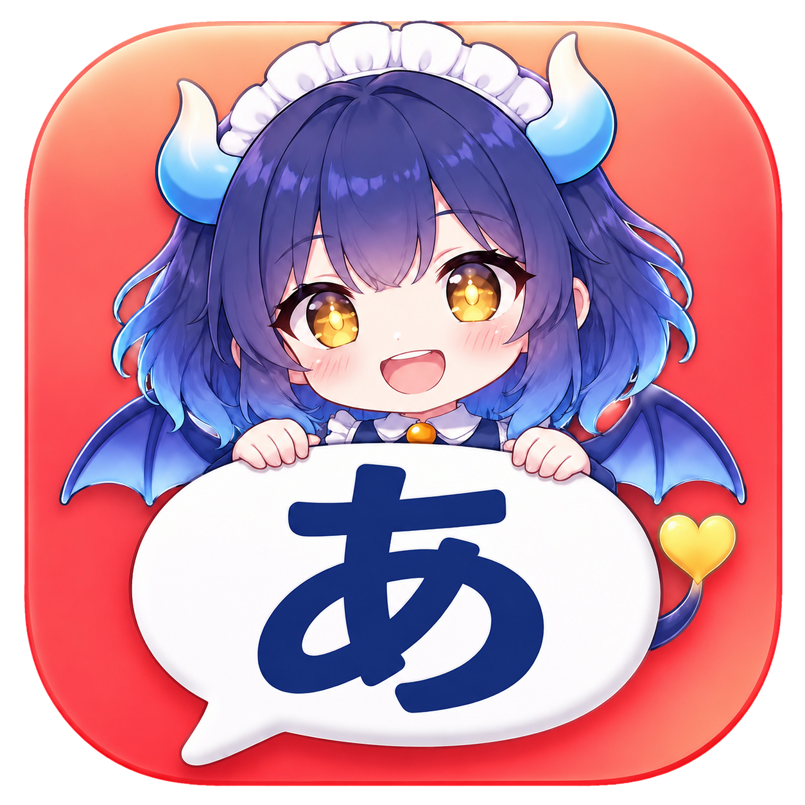
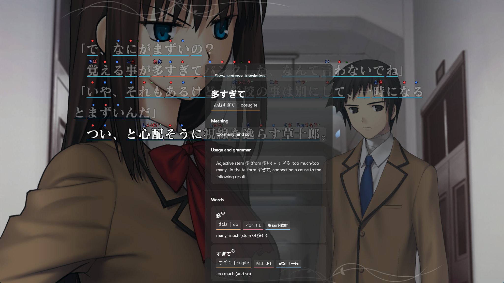
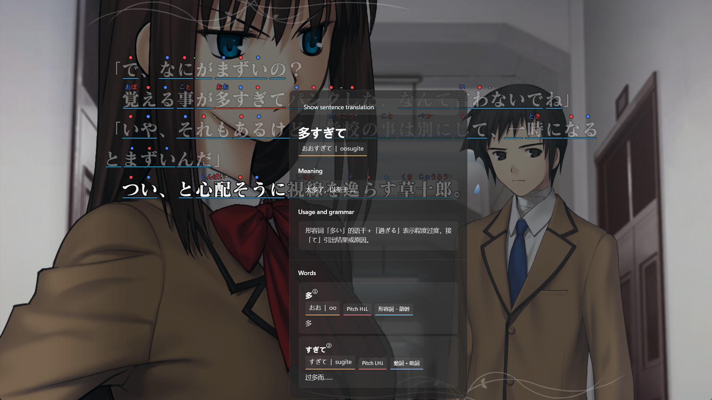
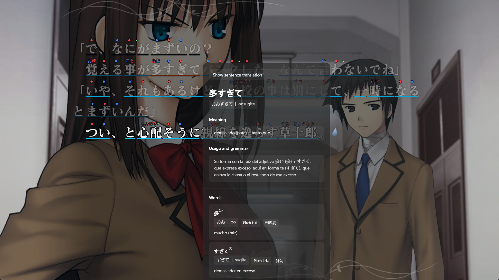
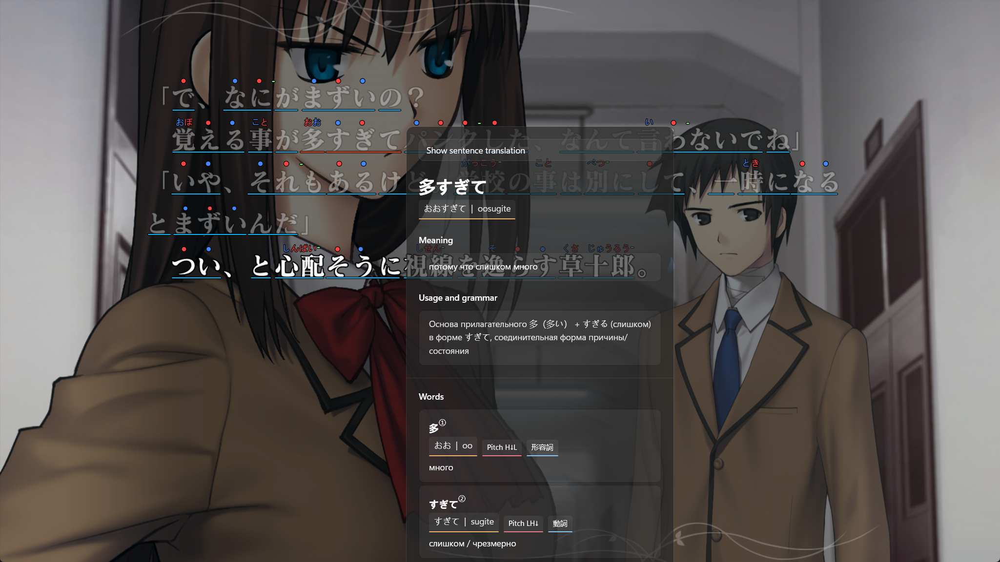
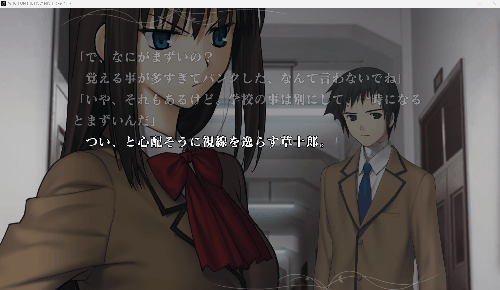
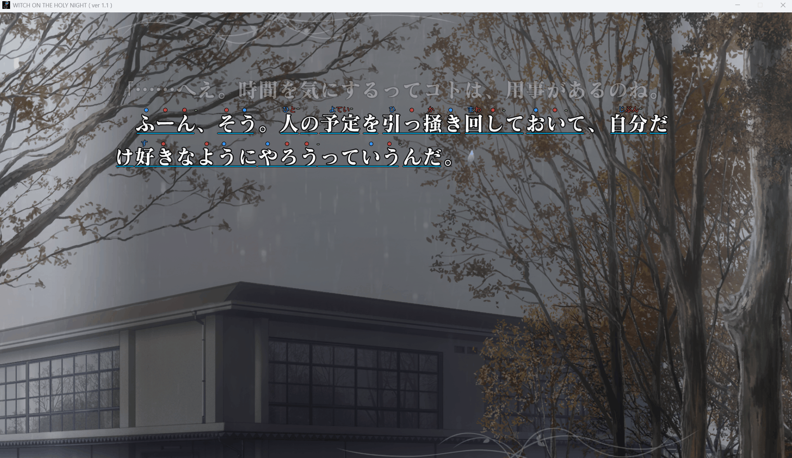
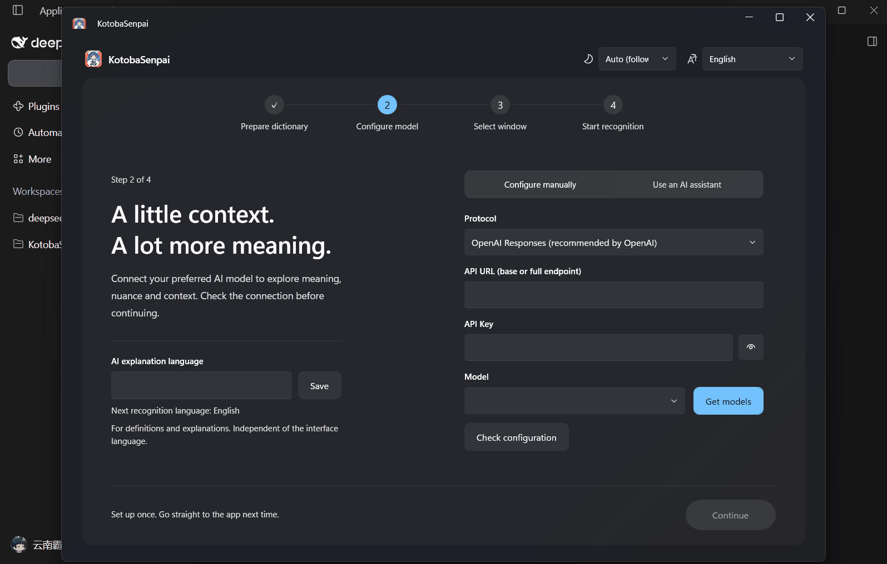
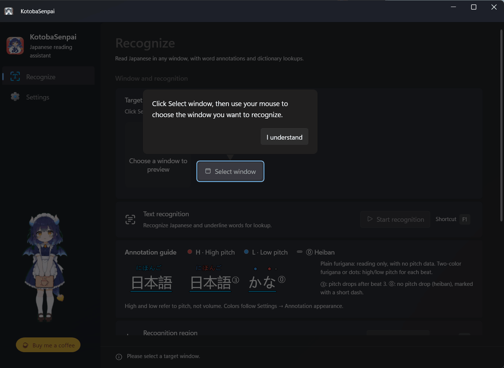

# KotobaSenpai

### The words stay on screen. So do you.

An AI reading companion for Japanese visual novels. Furigana, pitch accents, contextual explanations, and sentence translations appear beside the lines you are reading.

**English** · [简体中文](README.zh-CN.md)

[Features](#-why-kotobasenpai) · [First run](#-a-simple-first-run) · [Build from source](#-build-from-source)

  

## ✨ Why KotobaSenpai?

### 1. 🌍 Read Japanese in ANY LANGUAGE YOU CHOOSE

**There is no fixed target-language list.** Choose any left-to-right language supported by your AI model for contextual explanations and sentence translations. Set this language independently from the app interface. Available languages and output quality depend on the AI provider and model.

**The six languages below are just examples.** Click a screenshot to view it at full size.

<table>
  <tr>
    <td width="50%" align="center" valign="top">
      <strong>English</strong> 
      
    </td>
    <td width="50%" align="center" valign="top">
      <strong>简体中文</strong> 
      
    </td>
  </tr>
  <tr>
    <td width="50%" align="center" valign="top">
      <strong>한국어</strong> 
      
    </td>
    <td width="50%" align="center" valign="top">
      <strong>Español</strong> 
      
    </td>
  </tr>
  <tr>
    <td width="50%" align="center" valign="top">
      <strong>Português (Brasil)</strong> 
      
    </td>
    <td width="50%" align="center" valign="top">
      <strong>Русский</strong> 
      
    </td>
  </tr>
</table>

### 2. 👀 Keep readings on the game text

Furigana appears above kanji, with pitch-accent patterns marked alongside the reading when available. The annotations stay over the visual novel, so you can keep your eyes on the scene instead of moving between the game and a dictionary window.

### 3. 🧩 Get one meaning for this scene, not a wall of dictionary senses

KotobaSenpai uses the surrounding sentence to explain words and meaningful grammar patterns, including expressions split apart by other words, such as `A ... B`. It picks the contextual meaning that fits the scene and can return a full-sentence translation as part of the same analysis.

### 4. 🤖 Let your local Agent handle API setup

Copy KotobaSenpai's setup prompt into a local coding Agent such as Codex, Claude Code, or Cursor. After you provide the provider details and API key, the Agent can discover models, validate the connection, and apply the configuration for you. You stay in control of the credentials and provider you use.

### 5. 💸 Low token use, low cost

One real-use reference: about **US$0.075** for **30 minutes** of 魔法使いの夜 (_Witch on the Holy Night_) with **DeepSeek V4.1 Flash**. Actual cost varies with provider pricing, model, and token usage; this is an example, not a fixed rate.

### 6. 🧭 A guided first run, without a maze of settings

Onboarding walks you through the essentials: preparing the Japanese dictionary, configuring an AI model, and selecting the visual-novel window. The main controls stay focused on choosing a window, starting recognition, and enabling automatic recognition.

### 7. 🪟 Built for Windows desktop

KotobaSenpai is a Windows desktop app built with **.NET 10** and **WPF**. Its focused interface and in-window overlay are designed to keep reading responsive and unobtrusive.

## 🚀 A simple first run

1. Prepare the Japanese dictionary in onboarding.
2. Configure your AI provider manually or ask a local Agent to do it with you.
3. Select the game window and start reading.

## 🐉 Thanks for reading

The dragon maid is celebrating your next chapter.

