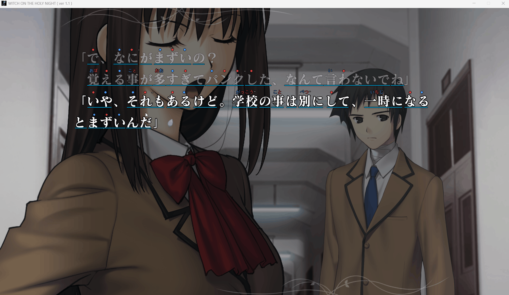
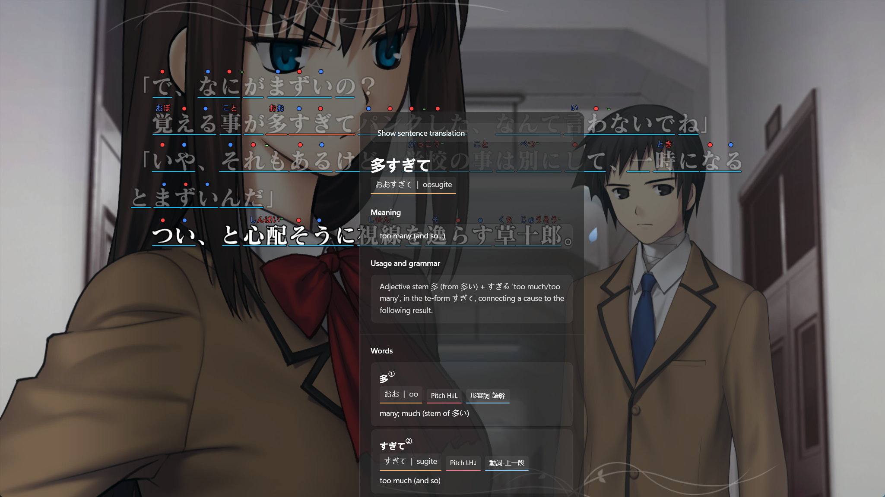
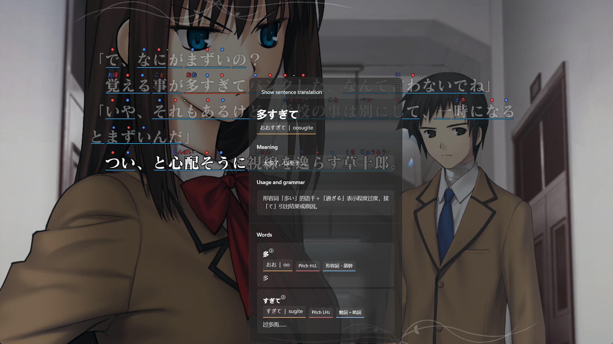
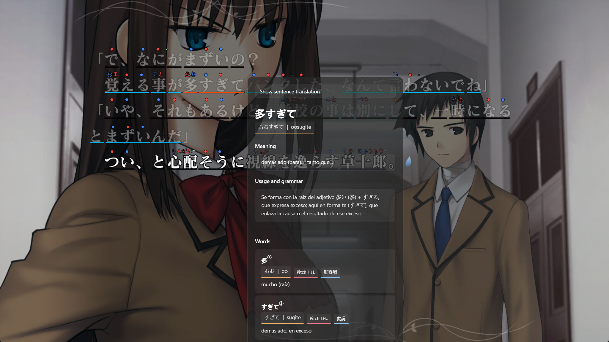
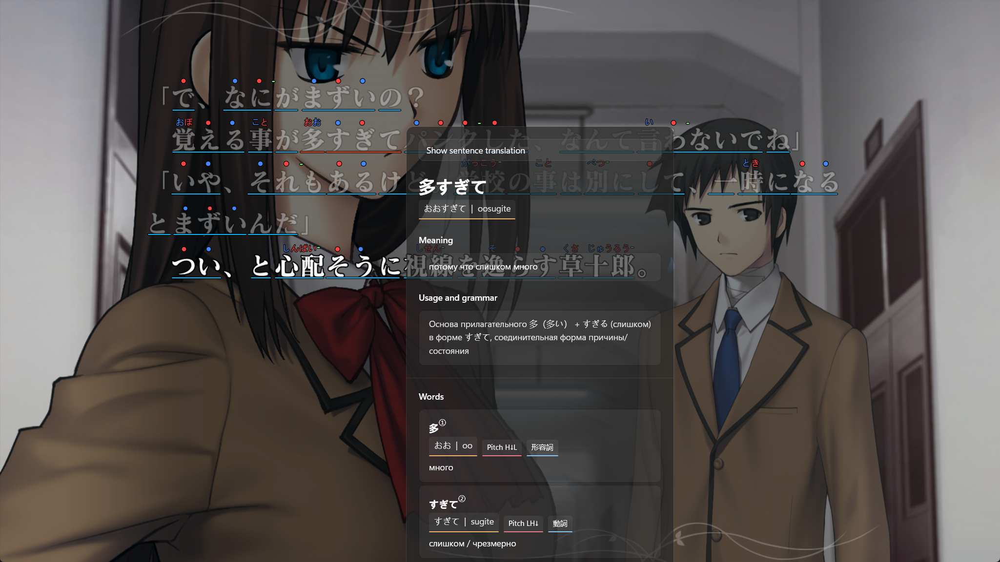
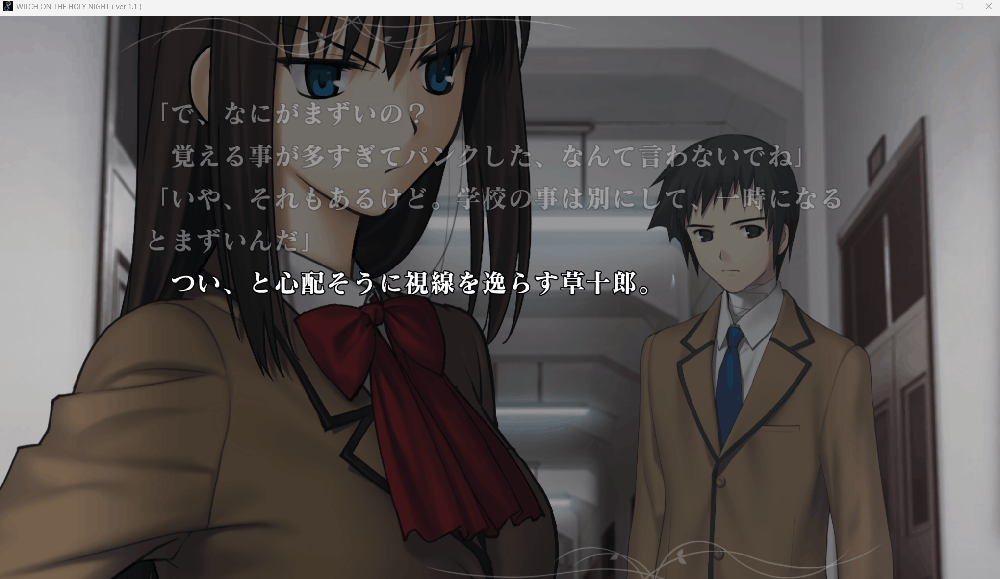
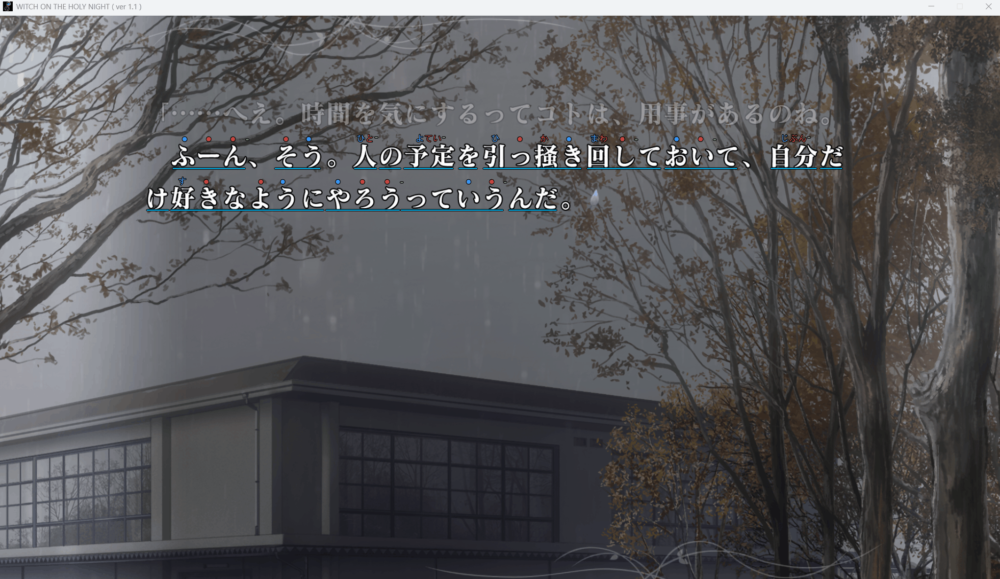
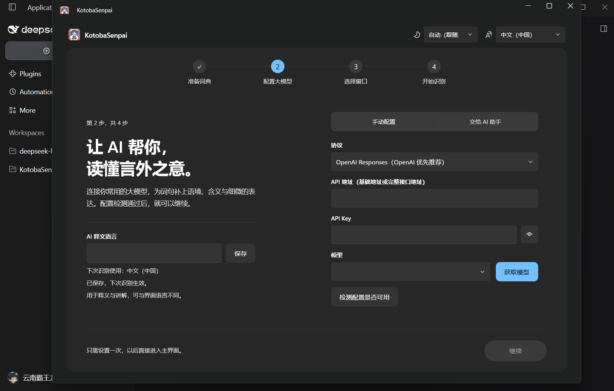
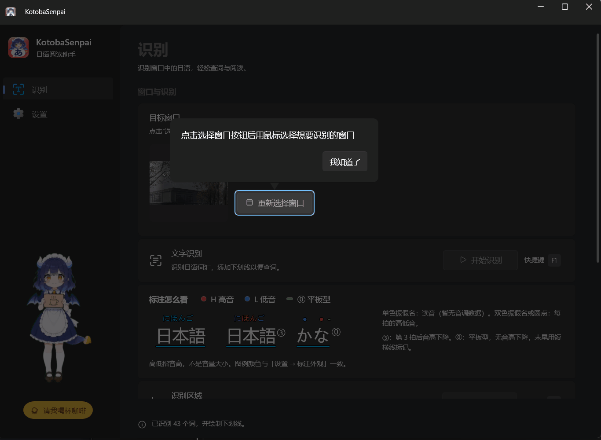

# KotobaSenpai

### 玩日语视觉小说，少按暂停，多看懂剧情。

为日语视觉小说准备的 AI 阅读助手：振假名、音调、语境释义和整句翻译，直接出现在你正在读的台词旁。

[English](README.md) · **简体中文**

[官方网站](https://treattrick.github.io/KotobaSenpai/zh/) · [下载最新版](https://github.com/TreatTrick/KotobaSenpai/releases/latest)

[核心卖点](#-为什么选择-kotobasenpai) · [首次使用](#-上手只需几步) · [从源码构建](#-从源码构建)

  

## ✨ 为什么选择 KotobaSenpai？

### 1. 🌍 用你选择的任何语言读懂日语

**目标语言由你选择，不受固定列表限制。** 语境释义和整句翻译可以使用所选 AI 模型支持的任何从左到右书写的语言，并独立于软件界面语言设置。实际可用语种和输出质量取决于 AI 服务商及模型。

**以下六种语言仅作示例。** 点击截图可查看原图。

<table>
  <tr>
    <td width="50%" align="center" valign="top">
      <strong>English</strong> 
      
    </td>
    <td width="50%" align="center" valign="top">
      <strong>简体中文</strong> 
      
    </td>
  </tr>
  <tr>
    <td width="50%" align="center" valign="top">
      <strong>한국어</strong> 
      
    </td>
    <td width="50%" align="center" valign="top">
      <strong>Español</strong> 
      
    </td>
  </tr>
  <tr>
    <td width="50%" align="center" valign="top">
      <strong>Português (Brasil)</strong> 
      
    </td>
    <td width="50%" align="center" valign="top">
      <strong>Русский</strong> 
      
    </td>
  </tr>
</table>

### 2. 👀 振假名和音调就在原文上方

汉字上方直接显示振假名；有音调数据时，也会在读音旁标出高低音。标注贴在视觉小说原文所在的位置，不必在游戏和词典窗口之间来回移开视线。

### 3. 🧩 结合当前剧情解释，不拿一堆词义让你猜

KotobaSenpai 会结合上下文解释词语和有意义的语法组合，包括中间被其他词隔开的 `A ... B` 形式。它给出符合当前情景的释义，并可在同一次分析中提供整句翻译。

### 4. 🤖 让本机 Agent 帮你配置 API

复制 KotobaSenpai 提供的配置提示词，粘贴给本机的 Codex、Claude Code 或 Cursor。你提供服务商资料和 API Key 后，Agent 可以查询模型、检测连接并应用配置；服务商和凭据仍由你自己选择。

### 5. 💸 Token 和费用消耗都很低

一条实际使用参考：使用 **DeepSeek V4.1 Flash** 游玩《魔法使之夜》（魔法使いの夜）**30 分钟约 ¥0.50**。实际费用会随服务商定价、模型和 Token 用量变化，这只是一次实测参考，不是固定费率。

### 6. 🧭 首次引导清楚，不用钻进复杂设置

内置词典会在启动时自动准备。首次引导只需配置 AI 模型、选择视觉小说窗口和开始识别三步。进入主界面后，常用操作围绕选择窗口、开始识别和开启自动识别展开。

### 7. 🪟 为 Windows 桌面打造

KotobaSenpai 是基于 **.NET 10** 和 **WPF** 开发的 Windows 桌面软件。界面简洁，窗口内叠加层专为快速、顺手地阅读而设计。

## 🚀 上手只需几步

完整安装包已包含日语词典，启动时自动准备，无需另行下载。

打开**关于**页即可检查 GitHub 最新正式版。下载完成后点击**更新并重启**，设置和词典会保留。详见[更新与发布说明](docs/app-updates.md)。

1. 手动配置 AI 服务，或让本机 Agent 协助完成。
2. 选择游戏窗口。
3. 开始识别，进入阅读。

## 🐉 谢谢你看到这里

龙女仆已经开心地跳起来啦！

