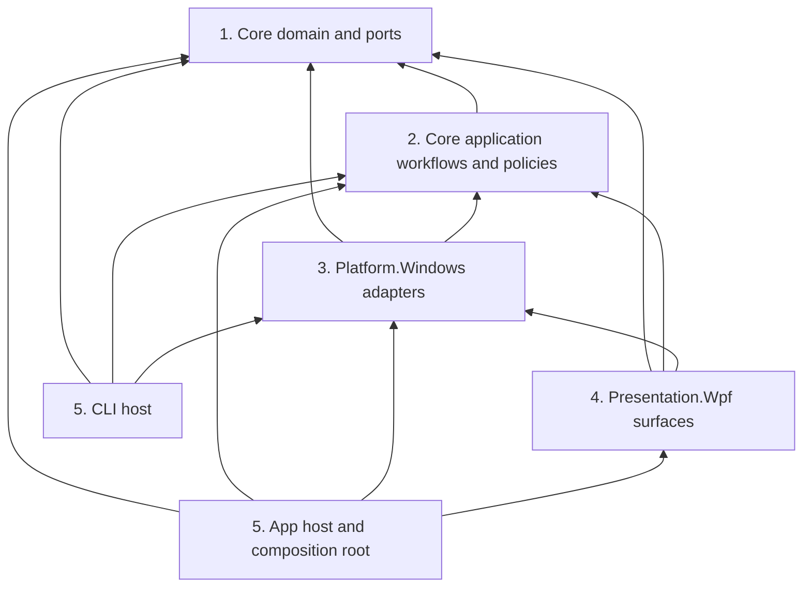

# Architecture

KotobaSenpai uses five logical layers across the Core, Platform.Windows, Presentation.Wpf, App, and CLI projects. The Core assembly contains both application workflows and the domain ports they coordinate; the split below describes its internal dependency rule as well as the project boundaries.

`App` also has a build-only project reference to `CLI`; it does not consume CLI types. The layer numbers describe responsibility and dependency direction, not a one-project-per-layer mapping.

The edges show compile-time project references, except for `Core application workflows -> Core domain and ports`, which is enforced between namespaces in the Core assembly.

| Rule | Placement | Principle |
| --- | --- | --- |
| Core has no dependency on WPF, App, or Platform.Windows. | Domain rules, use cases, and ports live in `KotobaSenpai.Core`. | Dependency rule: policy stays independent of delivery and infrastructure details. |
| Core slices depend only on lower Core slices. | Geometry, threading, settings, OCR, analysis, overlay, and workflow are ordered by the architecture tests. | Stable dependencies: lower-level policy does not import higher-level orchestration. |
| Platform.Windows references Core and implements its ports. | Win32 window tracking, capture, shortcuts, settings, and provider adapters live in `KotobaSenpai.Platform.Windows`. | Dependency inversion: adapters point to contracts owned by policy. |
| WPF surfaces live in Presentation.Wpf; App is the composition root. | Views and reusable windows are presentation concerns. App wires those surfaces, Core workflows, and Windows adapters through constructor injection. | Separation of concerns and explicit composition keep framework setup at the system edge. |
| Native imports are confined to Platform.Windows. | P/Invoke and Win32 calls live beside the Windows adapter code; presentation code uses the adapter seam and WPF's own HWND bridge. | Keep operating-system details behind an infrastructure boundary and prevent native imports from spreading into UI code. |
| Agent-facing results carry a typed outcome. | `AgentApiResult.Code` and `LlmDetectionResult.Code` are `AgentResultCode` in Core; the snake_case wire value is produced by a Platform converter and the localized explanation is mapped in App. | Typed contracts: orchestration and pages compare outcomes, not protocol strings, while the serialized contract stays a stable, versioned format. |

## Threading And Interop

`IUiThread` is a Core port because Windows adapters such as target tracking, automatic recognition, and global shortcuts must marshal callbacks without taking a dependency on WPF. `WpfUiThread` implements that port in Presentation.Wpf using `Dispatcher`; App registers it as a singleton for the desktop process. This keeps the contract usable by other hosts and keeps `Dispatcher` out of Core and Platform.Windows.

Win32 interop belongs to Platform.Windows because it owns operating-system APIs and their P/Invoke declarations. WPF-specific window code still uses `WindowInteropHelper` to obtain its own HWND, then delegates native styles, DPI, z-order, and placement to `OverlayWindowNativeHost`. This leaves the overlay renderer free of direct native imports and keeps Platform.Windows free of WPF references.

## Session Validity

One scoped `SessionEpoch` instance is shared by the recognition workflow, phrase-analysis cache, and session controller. Cache resets and session transitions advance its epoch; new automatic publications rotate an identity within the same epoch so later frames can supersede earlier UI publication without discarding reusable sentence analysis. Long-running work carries a snapshot and checks it before updating cache, session state, or the overlay. This puts validity state in Core and prevents each participant from maintaining an independent generation counter.
